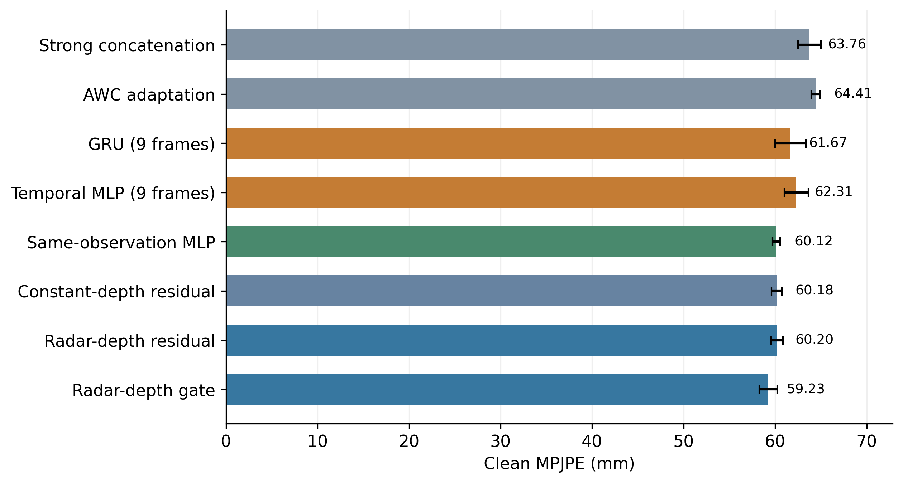
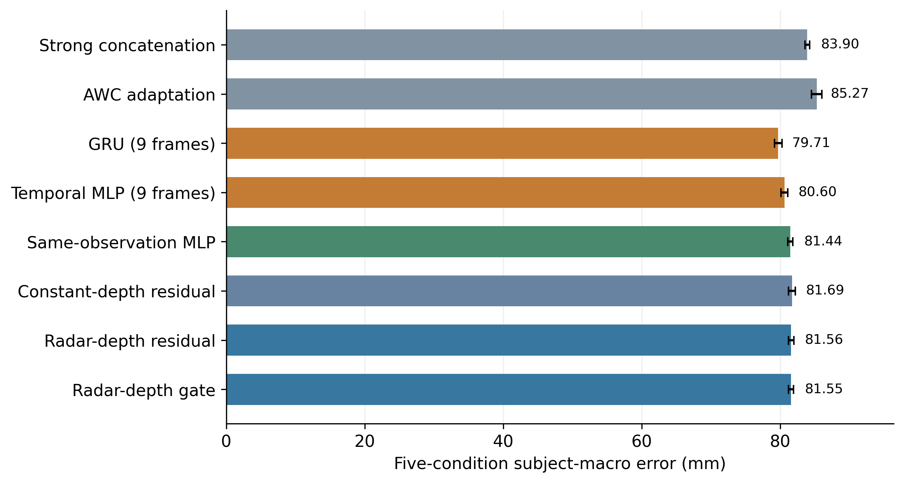

# 视频与毫米波人体姿态融合：论文交接说明

交接快照：2026-10-16T21:37:26+08:00。用途：交给其他研究者继续实验、核查和撰稿。源仓库：https://github.com/yjkira-01/monitor 。

## 1. 接手人先读的结论

主实验、几何OOF实验和同观测公平对照都已完成，并有独立核验。最终保留主体3/10/12/18尚未评价。目前没有证据支持“创新算法全面优于强基线”，论文方向与最终方法仍需研究者确定。

小数据1536帧中几何自由残差59.2732mm，优于同观测同宽度MLP63.1860mm。但扩大到12288帧后，同观测MLP正常60.1238/S81.4391mm，几何自由残差60.2021/S81.5609mm，原优势没有保留。单帧几何门控正常59.2348mm更低，综合S81.5475mm仍高于同观测MLP；9帧GRU综合S79.7126mm最好。不得沿用旧记忆中的“正在跑”或仅用小数据正结果作为最终结论。

## 2. 研究问题与实际数据

研究问题：RGB关键点与毫米波点云在退化、遮挡、缺模态下如何有效融合，显式相机几何是否比同观测神经表示更有价值？这是mRI人体姿态估计研究，不是跌倒检测或临床有效性实验。

mRI数据源：An、Li、Ogras，数据DOI https://doi.org/10.5061/dryad.9ghx3ffpp 。公开元数据标记CC0，许可原文与源元数据均保留；原始发布数据、标定与时间戳没有重新命名或伪造。

完整开发人口16人×12动作×64帧，共12288。训练主体1/2/4/7/8/9/11/13/14/15/16/17，共9216帧；验证主体5/6/19/20，共3072帧。每动作在1/3及2/3位置各取连续32帧。三初始化7/17/27，均固定80轮末轮，没有按验证选择checkpoint。

全部有限发布标签为主人口。已在正式训练前发现少量169/252/296m级异常标签，保留并另报预设1m四肢骨长/3m根半径敏感性；所有主方法共用稳健MPJPE和训练坐标中位数模板，另保留MSE控制。发布标签源于双相机，不是独立动捕真值。一个主体划分和多个相邻帧不能当作多个独立受试者验证。

真实像素条件为clean、noisy_dark（0.12亮度＋Gaussian标准差8）、固定矩形occlusion；另有视频或雷达完全缺失。S是这五条件、四验证主体的等权误差。旧1536帧另有dark条件，但dark未计入S；两个开发人口不混算。

## 3. 已实现的算法与公式

强融合基础网络将冻结RTMO检测的51维姿态表示与196×5雷达点集编码融合，输出17关节根相对3D。先统一预测双髋重中心，再构造几何候选。

雷达14维统计包含XYZ三个分位数9维、Doppler/Intensity的均值与标准差4维、非零行比例1维。训练主体内用IRLS Huber（0.15m阈值、ridge1、25步）拟合相机根深度，输入median/MAD标准化，预测裁剪0.5–10m；缺雷达用训练深度中位数。GT根深度只用作训练监督或显式标注的oracle，不作为部署输入。

令基础姿态为 $b_j$，相机内参为 $K$、旋转为 $R$，检测位置为 $(u_j,v_j)$。归一化射线为

$$r_j=((u_j-c_x)/f_x,(v_j-c_y)/f_y).$$

按实现的标签轴符号变换转到相机坐标，保留基础相对深度 $z_j$，以估计根深度 $d$ 得到

$$a_j=(r_{jx}(z_j+d),r_{jy}(z_j+d),z_j+d).$$

减双髋中心后旋转回标签坐标即几何候选 $c_j$。关节与双髋检测confidence均至少0.3时，$I_j=1$；否则不校正。

自由残差头输入15维观测/几何特征和16维关节嵌入，经32维隐藏层输出：

$$\hat y_j=b_j+I_j\,0.1\tanh(f_\theta(x_j,e_j)).$$

单位为m，每轴修正限制0.1m，1395参数；AdamW lr0.001/wd0.0001、batch256、梯度裁剪1、80轮末轮。门控头则输出sigmoid权重，沿 $c_j-b_j$ 校正。精确坐标符号、实现及归一统计以源码和快照为准。

12训练人内三折各8人训练、4人留出，基础预测及距离拟合都没有用该留出主体拟合；校正头仅训练这些OOF载荷。部署评价读取冻结full12基础模型。OOF8到full12存在误差分布偏移。新OOF专家的batch64、full12主训练batch128，整流程训练计算量高于普通单阶段基线，不能声称完全同更新次数。

相同观测MLP看到基础3D及双髋、原始归一化2D及双髋、完整静态R、置信度、估计距离和雷达可用性。它具有hidden32/embedding16、1843参数，控制了几何头的隐藏宽度且参数更多。几何与raw头共享OOF数据、优化器、80轮、修正上限和mask。

## 4. 最新完整主结果

| 方法 | 正常MPJPE / mm | 综合S / mm |
|---|---:|---:|
| 强拼接，髋重中心 | 63.7609 ± 1.2535 | 83.9022 ± 0.3543 |
| AWC论文训练规则适配 | 64.4111 ± 0.4550 | 85.2706 ± 0.7564 |
| GRU（9帧） | 61.6694 ± 1.6810 | 79.7126 ± 0.5686 |
| 时序MLP（9帧） | 62.3136 ± 1.3024 | 80.5976 ± 0.4756 |
| 相同观测神经网络（1843参数） | 60.1238 ± 0.4055 | 81.4391 ± 0.3481 |
| 常深度自由残差 | 60.1759 ± 0.5751 | 81.6932 ± 0.5015 |
| 雷达几何自由残差 | 60.2021 ± 0.6329 | 81.5609 ± 0.3966 |
| 雷达深度几何门控 | 59.2348 ± 0.9843 | 81.5475 ± 0.3658 |
| 常深度几何门控 | 59.4754 ± 1.2413 | 81.6353 ± 0.2579 |

±为三个初始化的样本标准差，不是独立划分误差或置信区间。完整18方法CSV及逐seed/逐主体结果在本包内。

单帧几何门控相对强concat正常降低约4.5261mm、S降低约2.3547mm；但相对同观测MLP正常只低约0.8891mm、S高约0.1084mm。自由几何残差相对同观测MLP两项均略差。雷达深度相对常深度自由残差的S差约0.1323mm、正常反而略差0.0262mm。因此雷达深度独立贡献较小，不能把校准视觉几何的全部收益归于雷达。

{width=14cm}

{width=14cm}

## 5. 基线与相关论文

AWC为《Towards Balanced Multi-Modal Learning in 3D Human Pose Estimation》的Shapley贡献与Fisher训练规则在本地两模态骨干上的重建，非MM-Fi官方完整模型。X-Fi保留官方X_Fusion核心，commit 9ba74cc98beb2d75a8eadbe74b1b151dc3d39614；强输入适配旧1536人口正常73.8105/S97.5552mm，不能与新人口直接算胜负。历史raw-CNN适配训练不稳与低学习率改善也全部保留，属于常规训练优化。

Knap等ICEIC2024（DOI10.1109/ICEIC61013.2024.10457094）完整4页已核读，原文Eq.(1)包含透视提升及雷达全局放置。Human3.6M上PA-MPJPE37.2/N-MPJPE61.7mm与本研究mRI根相对MPJPE不同。Amin等ICEET2023（DOI10.1109/ICEET60227.2023.10526102）前作摘要已核验、全文未取得。不能声称首次雷达解除单目尺度歧义。

文献阅读程度、DOI记录、原始摘要、已取得全文、作者代码及许可随包保存；未取得全文的文献不补造表格。理论工具OOF、残差、透视几何、稳健回归均有先例。

## 6. 论文作者可以使用的材料

可直接据实撰写：实验数据口径、算法实现、同人口基线比较、同观测公平控制、消融及负结果、标签异常和预处理审计。创新性、跨数据集效果、独立最终测试和实际现场泛化尚无足够证据，不应写成完成结论。

推荐写作顺序：先实验设置与可复现材料，再方法和全部消融，随后相关工作与讨论；摘要和最终贡献待方向确定后定稿。附有LaTeX工作模板、BibTeX、主表CSV、独立PNG300dpi/PDF/SVG结果图及图注。模板不预填虚假的最终贡献。

后续优先事项：固定比较对象与主指标；增加主体划分；解释几何优势为何随数据扩大消失；必要时检验训练预算与表示学习的关系；取得更直接同方向论文的完整可复现实现；方法与协议固定后才进行保留四人评价。当前没有新训练进程要接管，两条已登记流程状态均complete。

## 7. 包内目录和复现方式

写作包、主复现包、历史包解压到同一父目录，均恢复paper_handoff_20261016根目录。原始dataset_release.zip另下载放根目录。先运行tools/verify_results.py做不重训的CPU指标复核，再按REPRODUCE.md执行GPU完整重建审计。

15GB blurred_videos.zip未复制进交接压缩包，DATA_SOURCES.json给出官方Dryad下载地址、大小及SHA256。实际训练/验证使用的全部开发缓存、标定来源、点云与预测已包含，读表和复算指标不需要先下载大视频。像素端到端重审计时再下载、校验并按restore_raw_videos.py提取16开发人的color0；最终保留四人不解码。

Python环境按原版本记录，PyTorch2.11.0+cu128、NumPy2.3.4、ONNX Runtime GPU1.25.1、RTX4060 Laptop 8GB、IEEE FP32。原始源码保留哈希，不为迁移手改冻结脚本；若换GPU/依赖，先做数值重载检查。pip依赖目录与系统CUDA DLL不复制入包，用requirements重新安装。

## 8. 审计与交接完整性

MANIFEST.json记录每个交付文件的字节数、SHA256和所属包；SHA256SUMS.txt记录Release资产校验值。每个分卷ZIP通过合并视图检查CRC；Word文件经OOXML结构检查并渲染抽检。历史试运行和过时二进制的取舍明列EXCLUSIONS.json；正式主实验、几何、raw对照、强输入X-Fi及最终native X-Fi三组目标/低lr的权重和载荷均保留。

旧research笔记和报告属于当时状态，发生矛盾时以本交接快照和latest完整报告为准。根本地MEMORY可能包含与研究无关的设备/账户上下文，不公开；研究沿革已由实验目录与本说明承接。
